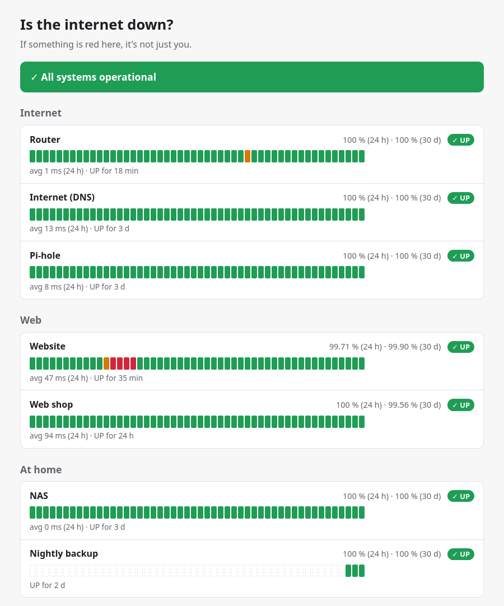

<p align="center"></p>

# uptime-kinomi

**📖 Documentation: [kinomi.readthedocs.io](https://kinomi.readthedocs.io/en/latest/)**

**The lightweight cousin of uptime-kuma.** A self-hosted uptime monitor and
static status page generator written in Rust, configured with plain **TOML
files** and producing **JavaScript-free HTML + CSS status pages**. It runs
on any Linux machine, and even on low-end hardware such as a
**Raspberry Pi 1**.

> ⚠️ **Status: pre-1.0.** All features described here are implemented,
> tested on a real Raspberry Pi 1 and with all parsers fuzzed. Before 1.0:
> polishing. Expect configuration details to change until then.

<p align="center"></p>

## What it does

- 🌐 **Watches websites and servers:** HTTP(S) status codes, keywords,
  response time, TCP ports, DNS records.
- 🔒 **Warns before your certificate expires.**
- 💾 **Checks that your nightly backup actually ran:** the backup script
  calls a push URL, and kinomi alerts you if it doesn't.
- 📡 **Tells you whether "the internet is down" or just the Wi-Fi**, on a
  public status page the whole family can open.
- 🔔 **Sends alerts** to ntfy, Gotify, Telegram, Discord, Slack,
  Mattermost, or any webhook.
- 📄 **Status pages**, public or private (password), with heartbeat bars,
  uptime, incidents, maintenance windows, badges, an Atom feed and
  `status.json`.

It needs a few MB of RAM and, even on a 700 MHz Pi 1, a few percent of the
CPU. It writes little to SD cards and runs as your normal user, without
root.

## Why not uptime-kuma?

[uptime-kuma](https://github.com/louislam/uptime-kuma) is great, but:

| | uptime-kuma | uptime-kinomi |
|---|---|---|
| Runs on Raspberry Pi 1 / Zero (ARMv6) | ❌ | ✅ first-class target |
| Runtime | Node.js + SQLite/MariaDB | single static binary |
| Memory | ~100+ MB | < 10 MB |
| Configuration | point-and-click web UI | **TOML files** (one per monitor), Ansible/Git friendly |
| Status pages | JavaScript single-page app | **static HTML5 + CSS, no JavaScript** |
| Data | database | **human-readable log files** + human-readable state files |
| Attack surface | full web application | tiny read-only server (or none at all) |

If you want a configuration UI, use uptime-kuma. If you want config as code
on any hardware, use kinomi.

## Install

On a Raspberry Pi or any Linux machine, as the user who should run kinomi
(no root needed):

```sh
curl -fsSL https://raw.githubusercontent.com/uptime-kinomi/uptime-kinomi/main/contrib/install.sh | sh
```

The script verifies the release signature, installs kinomi to
`~/.local/bin`, creates a starter configuration, starts a systemd user
service and enables weekly signed self-updates. Manual and Ansible
installations are described in the
[installation guide](https://kinomi.readthedocs.io/en/latest/installation/).
Then follow [First steps](https://kinomi.readthedocs.io/en/latest/getting-started/first-steps.html).

## A taste

One file per monitor, `~/.config/uptime-kinomi/monitors/blog.toml`:

```toml
config_version = 1
type = "http"
name = "My blog"

[http]
url = "https://blog.example.org/"
keyword = "Welcome"
tls_expiry_warn = "14d"
```

`uptime-kinomi check-config` validates the whole configuration. Everything
kinomi does ends up in plain log files, one per day:

```
2026-10-22T14:03:11Z monitor=blog result=UP latency_ms=123 msg="HTTP 200"
2026-10-22T14:05:11Z monitor=blog result=DOWN latency_ms=10000 msg=timeout
2026-10-22T14:05:11Z event=NOTIFY monitor=blog notifier=phone kind=down ok=true
```

## Documentation

- [Installation](https://kinomi.readthedocs.io/en/latest/installation/):
  `install.sh`, manual, Ansible, and which binary you need
- [First steps](https://kinomi.readthedocs.io/en/latest/getting-started/first-steps.html):
  a 30-minute tutorial
- [Monitors](https://kinomi.readthedocs.io/en/latest/monitors/) and
  [notifications](https://kinomi.readthedocs.io/en/latest/notifications/),
  with examples for every type
- [HTTPS and a reverse proxy](https://kinomi.readthedocs.io/en/latest/operations/reverse-proxy.html),
  [updates](https://kinomi.readthedocs.io/en/latest/operations/updates.html),
  [troubleshooting](https://kinomi.readthedocs.io/en/latest/operations/troubleshooting.html)
- The [specification](SPEC.md): the complete, normative description

## Security

No `unsafe` code, strict input limits, fuzzed parsers, nothing fetched from
monitored targets is ever shown or forwarded, strict CSP, no JavaScript, a
hardened systemd unit, and no root. Releases are signed with offline
[minisign](https://jedisct1.github.io/minisign/) keys, which `install.sh`
and `self-update` verify before anything is replaced (primary key
`RWQWavktNED2FrnDC8yLcpUPBKv4JeUoguh4zMF2wCBxwRJKVs3vRZu3`; both keys are in
[keys/](keys/)). See
[Updates](https://kinomi.readthedocs.io/en/latest/operations/updates.html)
and [SPEC.md](SPEC.md) §11-12. To report a vulnerability, see
[SECURITY.md](SECURITY.md).

## Contributing

kinomi is designed to be extended: **one source file per monitor type and per
notification type**. See [AGENTS.md](AGENTS.md) for architecture, code rules
and how to add a new monitor. This applies to humans and AI coding agents alike.

## License

MIT

---

*Keywords: uptime monitor, status page, Raspberry Pi 1, Raspberry Pi Zero,
ARMv6, single-board computer, SBC, Banana Pi, Orange Pi, uptime-kuma
alternative, self-hosted, Rust, static status page, no JavaScript, TOML
configuration, config as code, Ansible, heartbeat monitoring, push monitoring,
cron job monitoring, SSL certificate expiry monitoring, ntfy, Gotify, Telegram,
homelab.*
