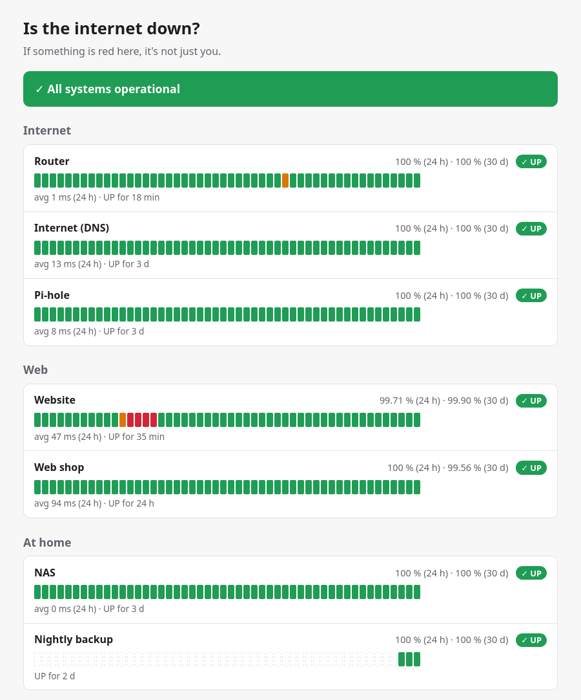

uptime-kinomi
=============

**uptime-kinomi** (or just *kinomi*) watches your websites, servers and
cron jobs, sends you a message when something goes down, and publishes
status pages that the whole family or all your customers can open.

It runs on any Linux computer, from a server to low-end hardware such as
the very first **Raspberry Pi**, using only a few megabytes of memory, as
your normal user, without root. You configure it
with plain text files, one per monitor, so your setup can live in Git.

         three groups of monitors (Internet, Web, At home), each with a
         heartbeat bar of the last checks, uptime percentages and the state.

   A public status page. Each bar is one check; the red ones were a short
   outage of the website half an hour ago.

What can it do for me?
----------------------

* Tell you when your **website** is down, or answers with an error page.
* Warn you **two weeks before your certificate expires**.
* Alert you when your **nightly backup did not run**.
* Show whether **"the internet is down"** or just the Wi-Fi, on a page
  everyone at home can open.
* Send alerts to your phone with **ntfy**, **Gotify** or **Telegram**, or
  to **Discord**, **Slack**, **Mattermost** and anything with a webhook.
* Watch **another Raspberry Pi** that watches it back.

.. code-block:: text

   2026-10-22T14:03:11Z monitor=blog result=UP latency_ms=123 msg="HTTP 200"
   2026-10-22T14:05:11Z monitor=blog result=DOWN latency_ms=10000 msg="timeout"
   2026-10-22T14:05:11Z event=NOTIFY monitor=blog notifier=phone kind=down ok=true

Everything kinomi does is written to plain log files like the one above,
one file per day, readable with ``less`` and ``grep``.

Where do I start?
-----------------

#. :doc:`Install kinomi <installation/index>`: one command on a Raspberry Pi
   or any Linux computer.
#. Follow :doc:`getting-started/first-steps`: your first monitor, a
   notification on your phone, a private page with a password, and a
   backup check. It takes about 30 minutes.
#. Look up what you need in the guides: :doc:`monitors/index`,
   :doc:`notifications/index`, :doc:`guides/status-pages`.

kinomi is pre-1.0: everything described here works and is tested on a real
Raspberry Pi 1, but configuration details may still change before 1.0. The
:doc:`changelog <reference/changelog>` lists every change.

.. toctree::
   :maxdepth: 2
   :caption: Getting started
   :hidden:

   installation/index
   getting-started/first-steps
   getting-started/concepts

.. toctree::
   :maxdepth: 2
   :caption: Monitors and notifications
   :hidden:

   monitors/index
   notifications/index

.. toctree::
   :maxdepth: 2
   :caption: Pages and announcements
   :hidden:

   guides/status-pages
   guides/incidents-and-maintenance

.. toctree::
   :maxdepth: 2
   :caption: Operation
   :hidden:

   operations/reverse-proxy
   operations/updates
   operations/logs-and-data
   operations/two-pis
   operations/backup-and-move
   operations/troubleshooting

.. toctree::
   :maxdepth: 2
   :caption: Reference
   :hidden:

   reference/configuration
   reference/cli
   reference/specification
   reference/changelog
